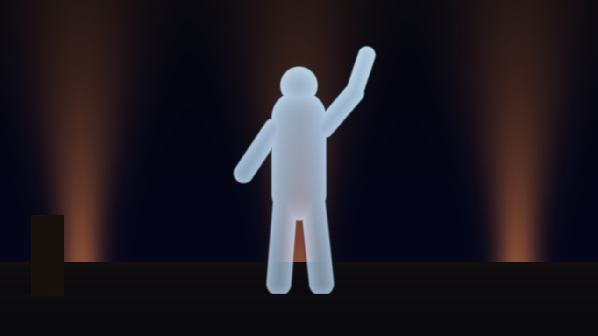
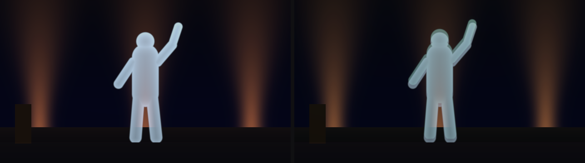
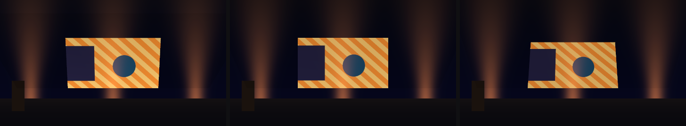
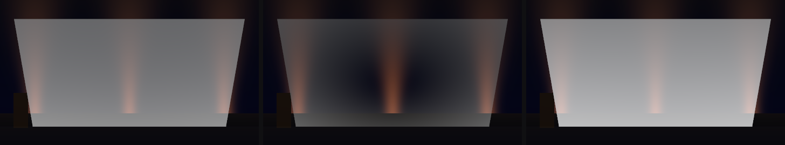
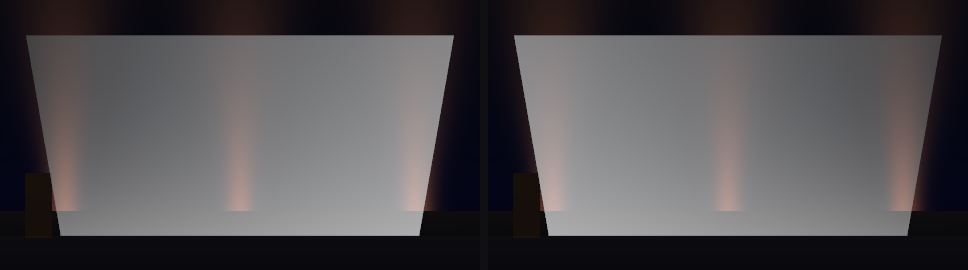
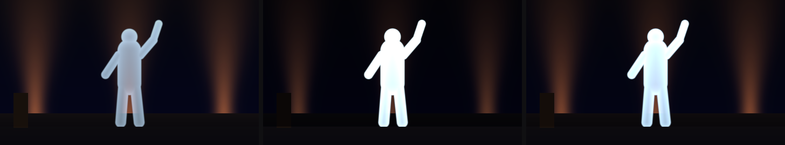
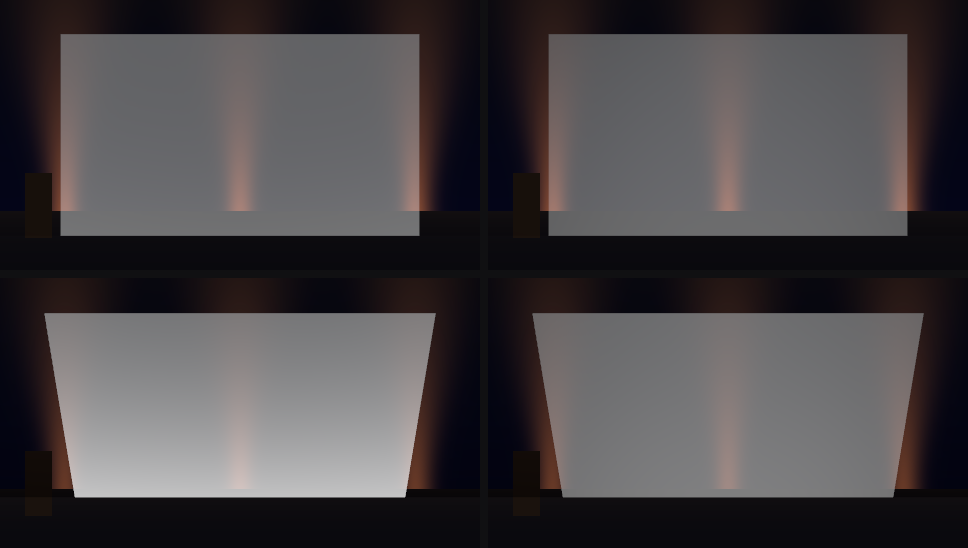
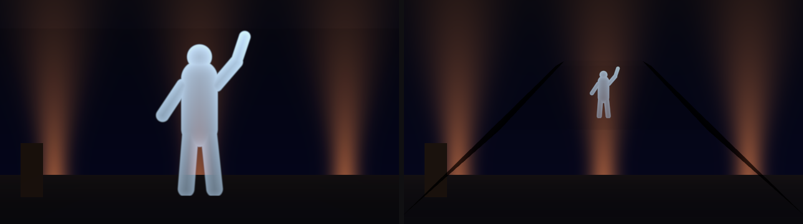
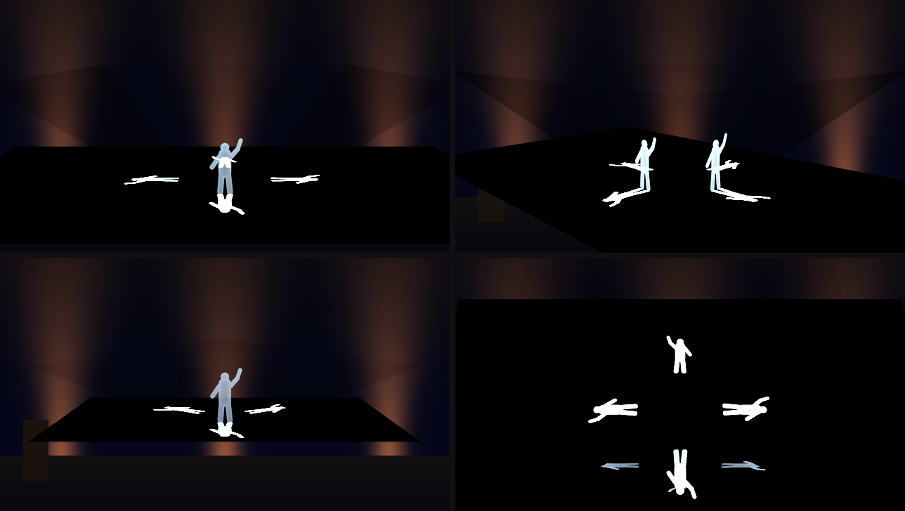
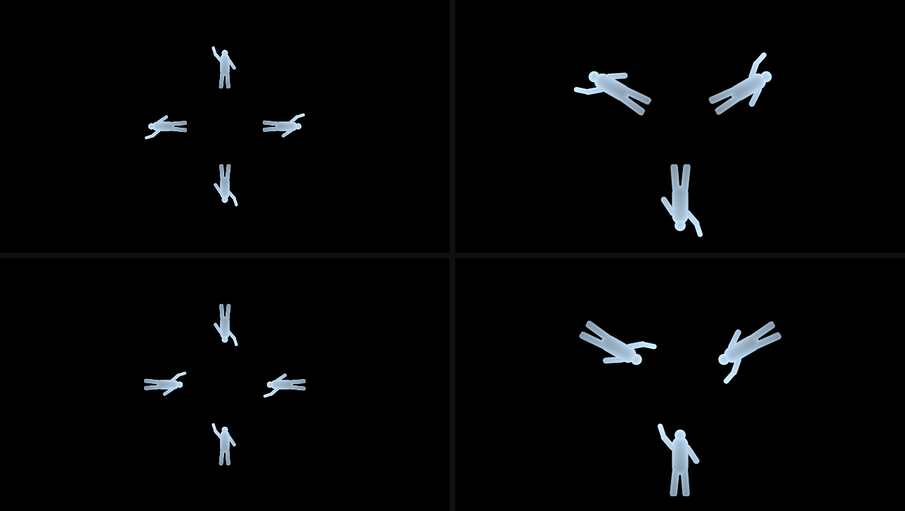

# Pepper

> **AI-assisted project.** This codebase was created with [Claude](https://claude.com/claude-code)
> (Anthropic), directed and reviewed by a human author. The optics are not
> asserted but measured. An offline harness drives the real plugin classes in a
> headless GL context and reads each claim back out of the picture:
>
> - a black source adds **exactly nothing**, to the bit;
> - a clear sheet reflects what it does not transmit, R + T = 1, to **3e-7**;
> - a polarised source vanishes at **Brewster's angle**, each colour's null
>   landing **0.003 px** from where atan n for that colour puts it;
> - at 45° the p reflection is the s reflection squared (Abelès) to **6e-8**;
> - a thick pane's second image lands **0.02 px** from Snell's 2 t tan θt;
> - a coated foil reflects what an independent thin-film model says, to
>   **3e-7**, from either side;
> - a polarised source through the pyramid's faces matches a separate 3D
>   trace to **1e-6**;
> - the foil's wobble peaks at **six of six** membrane mode frequencies,
>   measured by FFT.
>
> See [Status](#status). It has **never been loaded into Resolume on macOS**.
> On Windows, Resolume Arena 7.27.1 (software rendering, no GPU) loads both
> plugins, offers SW Pepper as a Blend Mode, hides Linear Light and drives its
> Opacity from the layer fader, and SW Pepper Feed passes the fleet's Arena
> gate. Check it in your own rig before trusting it in a show.

Pepper's ghost — a sheet of glass or foil reflecting a hidden screen over the
stage behind it — as an FFGL **mixer** for [Resolume](https://resolume.com)
Arena and Avenue, plus an **effect** that lays out a clip for a real pyramid
hologram. The same optics cover the Victorian pane, a Musion-style foil and the
plastic pyramid on a phone.



<sub>The repo's two generated cards through SW Pepper at its defaults: a PET foil
at 45°, the figure card on the hidden floor screen at +2.5 stops, the stage card
behind. Rendered by `pgtest`, the offline harness, not captured from Resolume.
The ghost only adds light: the orange beam behind the figure's legs comes
through it, and the stage is dimmed to about 0.87 by the foil even where there
is no ghost.</sub>

| | id | display name | bundle | type |
| --- | --- | --- | --- | --- |
| the pane, the foil and the pyramid, seen | `PG01` | `SW Pepper` | `Pepper.bundle`, `com.stoatworks.ffgl.pepper` | **mixer** |
| the cross layout a real pyramid is fed | `PG02` | `SW Pepper Feed` | `PepperFeed.bundle`, `com.stoatworks.ffgl.pepperfeed` | effect |

There's a [user guide](https://stoatworks-labs.com/software/pepper/guide/), also as
[docs/USER-GUIDE.md](docs/USER-GUIDE.md).

<!-- downloads:start -->

## Download

**[v0.1.0](https://github.com/stoatworks-labs/pepper/releases/tag/v0.1.0)** — prebuilt for macOS and Windows. Pick your platform:

<details>
<summary><b>macOS</b> — Universal (Apple Silicon + Intel)</summary>

| Build | Download | Size |
| --- | --- | --- |
| Universal (Apple Silicon + Intel) · .dmg disk image | [`pepper-0.1.0-macos-universal.dmg`](https://github.com/stoatworks-labs/pepper/releases/download/v0.1.0/pepper-0.1.0-macos-universal.dmg) | 486 KB |
| Universal (Apple Silicon + Intel) · .zip archive | [`pepper-macos-universal.zip`](https://github.com/stoatworks-labs/pepper/releases/latest/download/pepper-macos-universal.zip) | 423 KB |

</details>

<details>
<summary><b>Windows</b> — x64</summary>

| Build | Download | Size |
| --- | --- | --- |
| x64 · .exe installer | [`pepper-0.1.0-windows-x86_64-setup.exe`](https://github.com/stoatworks-labs/pepper/releases/download/v0.1.0/pepper-0.1.0-windows-x86_64-setup.exe) | 272 KB |
| x64 · .zip archive | [`pepper-windows-x86_64.zip`](https://github.com/stoatworks-labs/pepper/releases/latest/download/pepper-windows-x86_64.zip) | 241 KB |

</details>

All builds, checksums and release notes: [github.com/stoatworks-labs/pepper/releases](https://github.com/stoatworks-labs/pepper/releases).

macOS builds are signed and notarised and open normally. The Windows builds are unsigned, so SmartScreen warns once.

<!-- downloads:end -->

## Pepper's ghost is one sheet of glass

A clear sheet at an angle splits every ray into a reflected part and a
transmitted part, in the proportions Fresnel gives for that angle. Put a
brightly lit picture where the reflected rays land, keep it out of direct
view, and the eye sees that picture floating behind the sheet, over whatever
the transmitted rays reach. That is the whole trick, from the Royal Polytechnic
in 1862 to a foil on an arena stage. SW Pepper traces exactly that, per pixel,
in linear light, and these fall out of it:

- **The ghost is additive.** Black in the source contributes nothing and
  disappears; nothing can be darker than the stage behind the sheet; a ghost
  over a white wall cannot be seen. An alpha-over would let a dark source darken
  the stage, and that is one of the harness's negative controls.
- **The stage is dimmed by the sheet**, (1 − R)² τ / (1 − R² τ²) for its two
  surfaces — about 0.87 for PET at 45° — whether there is a ghost or not.
  Fading the source out leaves the glass in place, as dimming the lamp on the
  Victorian actor did.
- **Reflectance depends on the angle and the polarisation.** At 45°, one
  surface of PET reflects 12.7 % of s-polarised light and 1.6 % of p. An LCD
  whose light is polarised in the plane of incidence **vanishes at Brewster's
  angle**, which is why an LCD laid on the floor for a ghost can show nothing.
  Many panels are polarised at 45° instead: their ghost is lopsided, brighter
  on one side, and the 135° panel's is its mirror image. LED walls and
  projection are unpolarised.
- **Each colour has its own index.** Brewster's angle is a little different
  for red, green and blue, so near it a polarised ghost takes on colour.
- **A coat changes everything.** A bare film reflects about 13 % at 45°, which
  is why real foils are coated. A few nanometres of aluminium reflects nearly
  half, darkens the stage behind it, absorbs some of the light, and reflects
  less from the back than from the front. A quarter wave of titanium dioxide
  reflects about a third and absorbs nothing. Both are thin enough to
  interfere, so their colour and strength change with thickness and angle.
- **The screen has a falloff.** An LED tile is dimmer seen off its axis. From
  a level seat a 45° sheet shows the floor screen square on at the ghost's
  centre only. Away from the centre, from a raised seat, or in a steeper or
  shallower sheet, the screen is seen off its axis, and a narrow Viewing Angle
  dims the ghost there.
- **A thick pane gives a double image**, and a fainter third: the back surface's
  reflection comes out parallel to the front's, displaced along the pane by
  2 t tan θt. This is why a foil is used instead of glass: at thickness 0 the
  images coincide.
- **A tinted sheet** tints the stage and the back-surface images, which cross it
  twice, but not the front-surface image.
- **A foil ripples.** A tensioned film rings in its frame at the membrane's mode
  frequencies, and a tilt of δ turns the reflected ray by 2δ. So **the ghost
  swims and the stage behind does not**: a thin film does not deviate the light
  passing through it.
- **Keystone.** The ghost is the screen's mirror image in the sheet's plane. It
  stands upright at 45°, and at any other angle a level audience sees it as a
  keystone.
- **The pyramid** is the same sheet three or four times over a phone. Seen from
  one side, the near face shows its arm of the screen floating inside. At a
  corner the image splits across two faces. From above you see the screen itself.
  Light that reaches you through two faces has been turned between two planes
  of incidence, so a polarised phone looks different through each.
- **The screen can be above.** A pane can hang from an overhead screen, and a
  pyramid can stand apex up under one, as in a display case. The ghost is then
  the floor rig seen in a mirror: its keystone runs the other way.



<sub>Left: a PET foil, thickness 0, one image. Right: 4 % float glass tinted
(0.8, 0.95, 0.85). The back surface's image stands a little higher than the
front's — 2 t tan θt further along the pane — and it is tinted twice. Ripple
off in both.</sub>



<sub>The generated graphic card in a sheet at 38°, 45° and 55° from a level seat.
The ghost is wider at the top at 38°, a rectangle at 45° and narrower at the top
at 55°. `--geometry` measures the ratio at 40° and 50°: 1.0442 and 0.9605, as
the mirror predicts.</sub>



<sub>A white screen in a PET sheet at 33°, so the level ray meets it at 57°, near
Brewster's 58.8°. Left: unpolarised. Middle: polarised along the picture's
vertical, which is p for this rig — the ghost vanishes where the incidence is
Brewster's and the stage shows through. Right: along the horizontal, s, which
does not vanish.</sub>



<sub>The rig of the Brewster figure, with the screen polarised at 45° (left)
and 135° (right) in its picture. Across the ghost the field is partly s and
partly p, in shares that change from side to side, so each ghost is lopsided
(by up to 0.17 at 640×360) and the two are mirror images.</sub>



<sub>The shipped scene, ripple off, on a bare PET foil (left), with 5 nm of
aluminium (middle) and with a quarter wave of titanium dioxide (right), each
on the audience's side, at the same Source Level. Both coats brighten the
ghost and darken the stage. The aluminium also absorbs: between 14 % and 20 %
of the light goes nowhere.</sub>



<sub>A white screen at 0 stops: Lambertian on the left, Viewing Angle 60° on
the right (its light halves 30° off its axis). Top, a level seat: the 45°
sheet shows the floor screen square on only at the centre, and the ghost
dims away from it (to 0.69 of the Lambertian's at the screen's corners in
`--falloff`). Bottom, from 25° up:
the sheet is met more steeply and reflects more, and the whole screen is
seen about 25° off its axis, so the narrow screen's ghost is darker
everywhere.</sub>



<sub>`Mount = Screen Above`. Left: the pane hanging from an overhead screen.
Right: an acrylic pyramid standing apex up under one, from 10° up. Each face
still shows the clip the right way round. The overhead feed is laid out with
its arms' tops inward, which SW Pepper Feed does under the same Mount.</sub>



<sub>`Rig = Pyramid`, four acrylic faces at 45° over a phone showing the feed of
the figure card. Clockwise from top left: square on to a face from 10° up;
on a corner, where the figure is in two faces at once; from 60° up, where the
screen's own feed is seen directly through the faces; three sides. The bright
figures lying flat are the phone's screen seen directly: it is roughly ten
times brighter than its reflection, as it is in life.</sub>



<sub>SW Pepper Feed on the figure card. Top: for a pyramid standing on the
screen, each arm holds the clip top outward as a **mirror image**, because each
face of the pyramid mirrors it back the right way round. The common layout of
four rotated copies reads mirrored in a pyramid, and is the harness's negative
control. Bottom: `Mount = Screen Above`, for a pyramid apex up under an
overhead screen, where each arm's top points inward.</sub>

## Effect or mixer

**The rig is a mixer and the feed is an effect.** They are two bundles built from one core.

- The pane needs two pictures that take different light paths: the stage is
  **dimmed** by T, and the screen is **added** at R, per pixel, in linear light.
  An effect has one input, and no host blend mode does both. An alpha layer
  would need alpha 1 − T and colour R·L / (1 − T), which is the screen's own
  light L. That is over white whenever the screen is brighter than the stage,
  as it must be for a ghost to show. On top of that, a host blends in gamma
  space, with one alpha for three channels, where a tinted sheet dims each
  channel differently. So **SW Pepper is the hologram layer's Blend Mode**. The layer below
  is the stage (Dest) and this layer is the hidden screen (Src). This is how an
  operator already composites a ghost, usually with Add, which is this with
  T = 1 and R = 1, in gamma space.
- Resolume binds a mixer parameter named `Opacity` to the layer's opacity fader
  (measured on genlock, wipe, relay and lenticular). Here **Opacity is the
  source's light**: fade the layer up and the ghost appears; fade it down and
  the glass is still there.
- The pyramid **viewer** is the same mixer under `Rig = Pyramid`: the phone's
  picture (Src) and the room behind it (Dest).
- The pyramid **feed** has one input. It must work on a clip, a layer or the
  whole composition, which is how a dedicated pyramid output is fed, and a mixer
  can do none of those. So it is an effect, built from the same layout GLSL the
  mixer uses under `Screen = Feed`. **The feed you send to a real pyramid is the
  one the simulator looked into.**

## The controls

**SW Pepper**

- **Light**
  - **Linear Light** (on; off adds in gamma space, for comparison with Resolume's Add)
  - **Opacity** (the source's light, on the layer fader)
  - Source Level (−3 to +6 stops, default +2.5)
  - Source Black (the screen's own black, up to 5 % of white)
  - Polarisation (None, Horizontal, Vertical, 45 Degrees, 135 Degrees, relative
    to the screen's picture)
  - Viewing Angle (the screen's full angle at half brightness, 40° to 180°;
    180°, the default, is Lambertian)
  - Stage Level (−4 to +2 stops)
  - Spill (what the sheet reflects besides the screen — the pit, the room — up to 50 %)

  Linear Light is first on purpose: Arena does not show a mixer's first
  parameter, so index 0 holds a control whose default is right if nobody can
  ever reach it.
- **Rig**: Rig (Pane, Pyramid), Mount (Screen Below, Screen Above: the pane
  hangs from the screen, the pyramid stands apex up under it), Sheet Angle
  (25° to 65°, 45°), Sides (Four,
  Three), Centre (the pyramid's small end, 0.1 to 0.6 of the screen's short
  side), Screen (Feed lays Src out as SW Pepper Feed would; As Is takes Src as
  an already laid-out feed).
- **Sheet**: Sheet (PET Foil 1.65, Float Glass 1.52, Acrylic 1.49,
  Polycarbonate 1.585, at the d line, each dispersing), Coating (None,
  Aluminium, Titanium Dioxide, on the audience's side), Coat Thickness
  (aluminium 0 to 10 nm, 5 nm; titanium dioxide 0 to 2 quarter waves, one),
  Thickness (0 to 4 % of the rig; 0 is a film), Tint (the
  sheet's colour face-on), Ripple (the foil's steepest slope, 0° to 3°, 0.2°),
  Ripple Speed (the frame's fundamental, 0.05 to 4 Hz).
- **View**: Distance (1 to 12 rig sizes: the ghost's height for the pane, 0.6
  of the top's width for the pyramid), Elevation (−20° to 60°), Azimuth
  (−180° to 180°). The camera is a 30° lens orbiting the ghost. The stage (Dest)
  is what that camera sees behind the glass, so the view moves the glass and the
  ghost, not the stage.

**SW Pepper Feed**: Sides, Centre and Mount, with the same mappings as the
mixer's. Under Screen Above the arms' tops point inward.

## Browser demo

**<https://pepper-demo.stoatworks-labs.com/>** is SW Pepper, and
**[/feed/](https://pepper-demo.stoatworks-labs.com/feed/)** is SW Pepper Feed: every control
with its own name, group and default, a generated stage behind the glass and a generated
screen under it, or a picture of yours as the screen (decoded in the page, never uploaded).
The shaders are the plugin's own GLSL, spliced unedited (`demo/tools/check_shaders.py`, run
by `tools/verify.sh`), with one exception the page states: WebGL refuses a `?:` on a struct,
so the one in the thick-sheet trace is spelled as an equivalent call. The CPU half (the
controls, the rig, the foil's ripple, the coat's table) is a JavaScript port, and
`demo/tools/crosscheck/` renders it and `pgtest` from the same frames: in 27 cases across
both plugins, no pixel is more than one level of 255 from the plugin's. It is a demo, not
the plugin, and says what it leaves out.

## Build

Needs CMake and the Resolume FFGL SDK, which is a submodule.

```bash
cmake -B build -DCMAKE_BUILD_TYPE=Release
cmake --build build
cmake --install build    # → ~/Documents/Resolume Arena/Extra Effects
```

macOS builds universal (arm64 + x86_64) by default. Add
`-DCMAKE_OSX_ARCHITECTURES=arm64` for a faster development build. Both bundles
install to **Extra Effects**: Resolume has one FFGL folder, and mixers load
from it too (measured on genlock, wipe and relay).

## Building and testing

The harness renders the real plugin classes headlessly. The mixer gets two
inputs: `--input-a` is Dest, the stage; `--input-b` is Src, the hidden screen.
They may be different sizes, with different hardware padding, rendered to a
third size.

    ./build/pgtest --out /tmp/f.png        a picture through SW Pepper (--plugin feed for the feed)
    ./build/pgtest --list                  every parameter, kind and default
    ./build/pgtest --names                 names, ids, parameter 0, Opacity
    ./build/pgtest --mixer                 two inputs, two MaxUVs, and the guards
    ./build/pgtest --additive              the ghost only adds light, in linear light
    ./build/pgtest --energy                a clear sheet: R + T = 1, per pixel, every sheet
    ./build/pgtest --fresnel               Brewster's null per colour, Abelès' identity, 45° and 135° sources
    ./build/pgtest --double                a thick pane's images: their weights and where they land
    ./build/pgtest --coating               a coat against an independent thin-film model, from either side
    ./build/pgtest --falloff               the screen's angular falloff
    ./build/pgtest --polarised             a polarised source through the pyramid, against a 3D trace
    ./build/pgtest --geometry              dots land where the mirror puts them; the keystone; screen above
    ./build/pgtest --ripple                the foil rings at its frame's mode frequencies, by FFT
    ./build/pgtest --opacity               Opacity is the source's light; at 0 the glass stays
    ./build/pgtest --pyramid               each face shows the clip the right way round
    ./build/pgtest --feed                  the feed's arms are mirror images, where stated
    ./build/pgtest --mutation              one character of the shipped GLSL fails --double
    ./build/pgtest --bench                 720p through 4K, pane and pyramid
    ./build/pgtest --pipe                  raw RGBA frames in, frames out (filming, not a check)
    python3 tools/sweep.py                 no control of either plugin is silently dead
    tools/mutate.sh                        twenty-two one-character mutants, each caught
    python3 tools/figures.py               the README's pictures, remade
    tools/verify.sh                        all of it, on a fresh universal build

Every numeric check runs at **640×360 and 320×180**, on this Mac's GPU **and**
on Apple's software renderer. Every check carries a **negative control**: a
fault switch in the shipped plugin that builds the wrong answer into the real
shader, and that the check must reject. Every tolerance is derived from
something stated rather than from the number this machine printed first.
[AGENTS.md](AGENTS.md) lists every number and where it comes from.

## Status

**v0.1.0.** Verified by measurement on an Apple M4
Max, macOS 26.4.1, 2026-11-02, at 640×360 **and** 320×180 unless stated, on
the GPU and on Apple's software renderer:

| Check | Result |
| --- | --- |
| Two inputs, two sizes, two MaxUVs | Dest 200×120 of 256×256, Src 96×70 of 128×128, out 320×200 and 320×180: **0 padding pixels** reached the picture through the glass or in it, every quadrant within **1.3e-7** of flat, both markers where predicted |
| The guards | a null input array, zero inputs, one input, a null Dest, a null Src and a zero-sized Dest return `FF_FAIL`; so do the feed's null and missing input |
| Additive | a black Src adds **0 bytes**; under it the stage is dimmed by exactly the film's T at each pixel's incidence (**2.7e-7**); no pixel is darker than that for any Src; L(stage, screen) = L(stage, 0) + L(0, screen) to **2.5e-7**; the stage alone is T × Stage Level × its sRGB-decoded light to **2e-7** |
| Energy | R + T = 1 at every pixel for all four sheets, worst **3.1e-7**; a tinted sheet falls short by exactly its absorption |
| Fresnel | for all four sheets and each of red, green and blue at its own index, the p ghost's null within **0.003 px** of Brewster's row for that colour (PET: rows 181.30, 180.00, 177.36), p/s **3e-6** there; at 45° R_p = R_s² in every channel to **6e-8** (PET green: R_s 0.12823, R_p 0.016442); s rises monotonically with incidence; sources at 45° and 135° give R for that field at every pixel to **1.2e-7**, mirror images of each other, each lopsided by up to 0.169 |
| Thick pane | W1 = (1 − W0)² W0 τ² to **1.8e-7** relative and W2 = (1 − W0)² W0³ τ⁴ to **6.5e-5**; the second image's edge at row **187.95**, Snell predicts 187.93. Bending each colour's rays by its own index would part its red and blue edges by **0.05 px**; the plugin bends them all by green's |
| Coating | the plugin's coat (an Airy sum) against the harness's own transfer matrix in another sign convention, every sheet, coat, channel and angle, to **1e-15**; through the plugin, seven coats on glass and PET, film and 1 % thick: the ghost, polarised and not, the stage through it, the absorption and the reflection from inside within **2.7e-7** of the model; 5 nm of aluminium on glass reflects 0.47 from the front and 0.39 from inside |
| Falloff | Viewing Angle 180°, 120° and 60°: the ghost is the film's R × cos^p off the screen's normal to **8e-8** |
| Polarised pyramid | four and three sides, bare, aluminium and titanium dioxide, apex down and up, elevation 0° to 25°: every polarisation's light within **1e-6** of a separate 3D coherency trace; Horizontal and Vertical differ by up to 0.51 |
| Geometry | six views (sheet 40° to 55°, elevation to 15°, azimuth to 25°) and three with the screen above: every dot within **0.05** of its tolerance of the mirror image, upright and the right way round; at 45° the ghost is a rectangle (1.0000), at 40° and 50° a keystone of **1.0442 and 0.9605** against 1.0441 and 0.9605; at 40° under an overhead screen **0.9577**, as predicted |
| Ripple | a Dest marker through the rippling foil moves **0.0002 px**, the ghost of a dot 7.7 px; the dot's track peaks at **6 of 6** mode frequencies and nowhere else above 5 % |
| Opacity | Opacity 0 is the black-Src picture to the bit, 8-bit and float; the ghost's light is linear in Opacity to **2.3e-7** |
| Pyramid | apex down and apex up, four sides from azimuth 0, 90, 180, −90 and three from 0, 120, −120: the near face shows the clip the right way round, its dots within **0.08** of tolerance; from 60° up the screen's 12 dots are where they are, each arm mirrored |
| Feed | below and above, every dot within **0.19 px** of its predicted place (tolerance 0.375), every arm a mirror image (determinant −1), black outside the arms, alpha 255 everywhere; the mixer's own pyramid screen shows the feed's dots where the feed drew them, apex down and apex up |
| Negative controls | every one fails its check: folded MaxUV, the coat's table left bound, alpha-over, gamma-space add, one surface, r_p with cosines swapped, s and p swapped, one index for every colour, the angle taken clockwise, one pass through the thick pane, the tint once, a symmetric metal coat, an incoherent coat, the falloff ignored, polarisation forgotten at all but the last face, a fixed 45° mirror, a mirrored screen, an overhead screen laid out as a floor one, locked modes, Opacity as a crossfade, rotated arms |
| Mutation | the shipped `--mutation` (the tint's path from the incidence, not the refraction) fails 3 `--double` assertions; `tools/mutate.sh` catches **22 of 22** one-character mutants across the GLSL and the C++ |
| No dead controls | all **26** of SW Pepper's controls and all **3** of the feed's change the picture at 480×270 (Coat Thickness under a coat); the rest are the About block |
| Host metadata | `oxbow probe` reads **SW Pepper / PG01 / mixer / inputs 2..2**, parameter 0 **Linear Light**, and **SW Pepper Feed / PG02 / effect / 1..1**; oxbow's selftest renders the feed and is refused by the mixer (one input) |
| Render cost | one 30-frame run at shipped defaults (the PET foil, rippling), `glFinish` both sides, on a shared machine with other sessions' checks running: the pane **0.07 / 0.21 / 0.39 ms** a frame at 720p / 1080p / 4K, the pyramid **0.06 / 0.08 / 0.31 ms** — 2.3 % of a 60 fps frame at most. Not asserted; another GPU will differ |
| macOS binary | universal (`x86_64 arm64`), both bundles export `plugMain` and ad-hoc sign |
| Resolume Arena, Windows | the release workflow's build of 40d3a05 in Arena 7.27.1 on Windows x64, Mesa llvmpipe, no GPU: both plugins load and register (PG01 as a mixer, PG02 as an effect) and their shaders compile; SW Pepper Feed passes the fleet's Arena gate **twice, 9 of 9**, all 4 of its controls moving Arena's picture; SW Pepper, probed over REST, is offered as a Blend Mode and a transition, exposes **30 of 31** parameters (Linear Light hidden), and its Opacity follows the layer fader at 0.2, 0.85, 0.5 and 1.0, read back and logged by the plugin, a REST write to it overridden. [AGENTS.md](AGENTS.md#what-pepper-showed-in-arena) has the logs |

Run `tools/verify.sh` before believing any of it.

**What is not done.**

- Pepper has **never been loaded into Resolume on macOS**, or on any GPU.
- **No frame of SW Pepper's output in Resolume has been captured.** Arena's REST
  API serves no picture of a mixer, so the Windows probe shows it loading,
  compiling and taking its controls, not drawing the right ghost. The ghost is
  measured in the harness only. SW Pepper Feed's picture was captured there.
- A layer transition through SW Pepper ramps its Opacity, but Arena never sent
  it 1.0, so a transition ends by cutting from ghost-over-stage to the plain new
  clip. It's meant as a blend mode.
- The harness has run on two rasterisers, this Mac's GPU and Apple's software
  renderer. No other has run it.

It also leaves out, on purpose:

- haze, scattering and dust on the foil, which would need a blurred copy of
  each picture and a render pass the plugin does not have;
- the birefringence of drawn PET film, which shows only through a polariser
  and depends on a roll's own axes;
- the colour fringe a thick sheet's back images would get from each colour
  bending by its own index. They all bend by green's. The fringe is a fraction
  of a pixel: 0.7 % to 1.7 % of the back image's offset.

[AGENTS.md](AGENTS.md) lists everything assumed rather than measured, and the
decisions taken without asking.

<!-- attributions:start -->
This project is built on other people's work — see [ATTRIBUTIONS.md](ATTRIBUTIONS.md).
<!-- attributions:end -->

## Licence

MIT — see [LICENSE](LICENSE).
