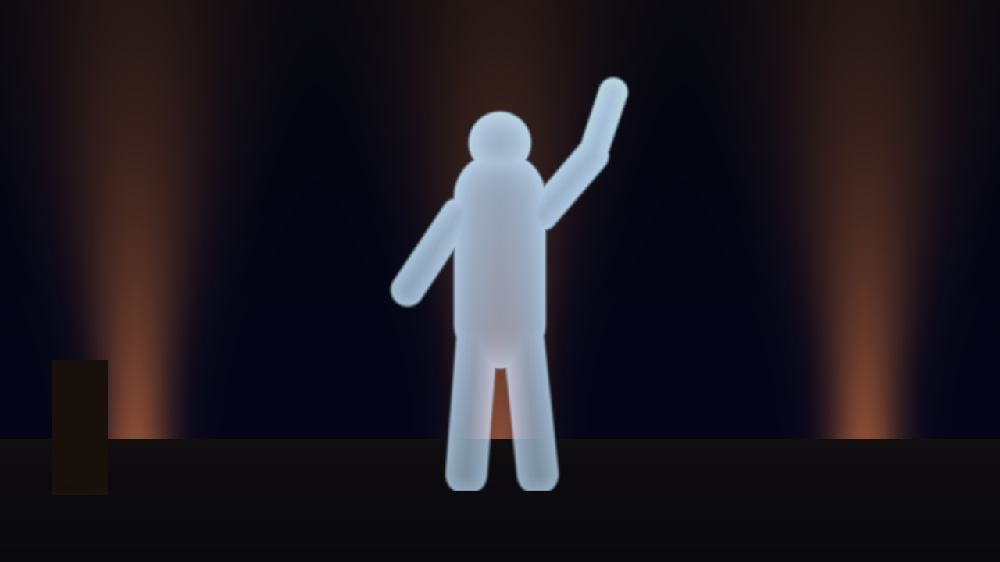

# Pepper user guide

Pepper is Pepper's ghost for [Resolume](https://resolume.com) Arena and Avenue: a sheet
of glass or foil at an angle, reflecting a hidden screen over the stage behind it. It
comes as two FFGL plugins:

- **SW Pepper**, a **mixer**. Put it in a layer's Blend Mode and the layer below is the
  stage, this layer is the hidden screen, and the layer's opacity fader is that
  screen's brightness. It does a Victorian pane, a Musion-style foil or the plastic
  pyramid people stand on a phone.
- **SW Pepper Feed**, an **effect**. It lays a clip out as the cross a real pyramid
  hologram is fed, each arm mirrored so the face it lands in shows it the right way
  round.

Nothing is painted on. Every pixel is a ray traced through the sheet in linear light,
so the ghost is what the glass reflects at that pixel's angle, and the stage gets what
it lets through. The ghost only ever adds light, it vanishes at Brewster's angle under
a polarised screen, a thick pane doubles it, a foil makes it swim, and a coat makes it
brighter and the stage darker, all because that's what the sheet does.



*The repo's two generated cards through SW Pepper at its defaults: a PET foil at 45°,
the figure card on the hidden floor screen at +2.5 stops, the stage card behind.
Rendered by the offline harness rather than captured from Resolume. The ghost only adds
light: the orange beam behind the figure's legs comes through it, and the stage is
dimmed to about 0.87 by the foil even where there's no ghost.*

> **Before you rely on this:** this is **v0.1.0**, the first release. The optics are
> measured, not just asserted. An offline harness drives both plugins with real inputs
> at two sizes, on the GPU and on Apple's software renderer. A black screen adds
> **exactly nothing**, to the bit. A clear sheet reflects what it doesn't let through,
> R + T = 1, to **3e-7**. A polarised screen vanishes at **Brewster's angle**, each
> colour's null landing **0.003 px** from where that colour's index puts it. A thick
> pane's second image lands **0.02 px** from where Snell's law puts it. A coated foil
> reflects what an independent thin-film model says, to **3e-7**, from either side. A
> polarised screen through the pyramid's faces matches a separate 3D trace to **1e-6**.
> The foil's wobble peaks at **six of six** membrane mode frequencies. Every check
> carries a negative control that fails, and all 29 controls change the picture.
> It's **never been loaded into Resolume on macOS**. On Windows, in Resolume Arena
> 7.27.1 on software rendering (no GPU), both plugins load; SW Pepper is offered as
> a Blend Mode, hides Linear Light, and takes its Opacity from the layer's fader;
> and SW Pepper Feed passes the fleet's Arena check, every control moving the
> picture. Nobody has yet captured a frame of SW Pepper's ghost inside Resolume.
> **Try it on a spare layer first**, and shout if anything misbehaves.
>
> This codebase was created with AI assistance, directed and reviewed by a human
> author.

---

## Installing

Download the build for your platform. For macOS there's a universal `.dmg` or `.zip`
(Apple silicon and Intel), **Developer ID-signed and notarised** so the bundles just
load (the signing happens on my Mac shortly after each release is published, so a
download made in the first few minutes may need **Open** from the context menu once),
and for Windows an x64 installer or `.zip`. Every download has **both plugins** in it:
`Pepper.bundle` and `PepperFeed.bundle` on macOS, `Pepper.dll` and `PepperFeed.dll` on
Windows. Put them in Resolume's FFGL folder, then restart Resolume:

```
macOS    ~/Documents/Resolume Arena/Extra Effects/
Windows  %USERPROFILE%\Documents\Resolume Arena\Extra Effects\
```

Avenue uses the same layout in its own folder. Yes, it's **Extra Effects** for the mixer
too: Resolume has one FFGL plugin folder, and sources, effects and mixers all load from
it. There's no `Extra Mixers`.

The Windows installer puts both DLLs there for you, per user, with no admin rights
needed. It defaults to Arena's folder (Avenue's if only Avenue is installed) and lets
you change it. The Windows builds aren't code-signed. Plugin files aren't gated the way
`.exe` files are, so Resolume loads them as normal; only the installer trips
SmartScreen, once: **More info** → **Run anyway**.

Where they show up in Resolume:

- **SW Pepper** is a mixer, so it isn't in the effects browser. It's in a layer's
  **Blend Mode** list, beside Resolume's own blend modes (and in the layer's transition
  list, which isn't what it's for).
- **SW Pepper Feed** is an ordinary effect, in the effects browser. Put it on a clip, a
  layer or the whole composition.

---

## It is a mixer, not an effect

An effect gets one picture. A ghost needs two, and they take different paths through
the glass: the stage is **dimmed** by what the sheet lets through, and the screen is
**added** by what it reflects. No blend mode does both, so SW Pepper is the blend mode.

| Input | In the code | In Resolume | What it is here |
|---|---|---|---|
| **Stage** | `inputTextures[0]` (Dest) | the layer **below** | What you see through the sheet: the set, the band, the room. |
| **Screen** | `inputTextures[1]` (Src) | **this** layer, the one whose Blend Mode is SW Pepper | The hidden screen the sheet reflects: the ghost. |

Put the stage on one layer and the ghost's clip on the layer **above** it, then set the
upper layer's **Blend Mode** to SW Pepper. Handed only one picture, the plugin declines
to draw. The two layers don't have to be the same size; each is read at its own
resolution.

If you composite ghosts already, you've probably used **Add**. SW Pepper is Add done the
way the glass does it: in linear light, with the stage dimmed by the sheet and the ghost
scaled by its reflectance at every pixel's angle, instead of both at full strength in
gamma space.

---

## Start here

**The layer's opacity fader is the hidden screen's brightness.** SW Pepper's
brightness control is a parameter called **Opacity**, and Resolume drives a mixer
parameter of that name from the layer's own opacity fader. Fade the layer up and the
ghost appears; fade it down and the ghost goes, but the glass stays: the stage is still
seen through it, a little dimmer, as it would be in a theatre with the lamp on the
hidden actor turned off.

**Use a ghost clip that's bright on black.** Black on the hidden screen adds nothing at
all, so a figure on black floats over the stage, and a full-frame clip shows as a lit
rectangle. A ghost over a white stage can't be seen, in life as here.

Then, in this order:

1. **Sheet Angle** away from 45° and back. The ghost is the screen's mirror image in the
   sheet, so at 45° it stands upright, and either side of that it keystones.
2. **Polarisation** to **Vertical**, with Sheet Angle around 33°. That's an LCD lying on
   the floor with its light polarised in the plane of incidence: across the middle of
   the ghost the sheet reflects none of it, at Brewster's angle. **Horizontal** is the
   other way, and brighter than unpolarised light everywhere.
3. **Sheet** to **Float Glass**, and **Thickness** up. The back surface's reflection
   steps out from under the front's: the double image that is why stages use foil.
4. **Ripple** up. The foil shivers at the mode frequencies of a stretched membrane, and
   the stage seen through it doesn't move at all.
5. **Coating** to **Aluminium** and **Coat Thickness** up. The ghost brightens and the
   stage darkens, as a thicker metal film reflects more and passes less.
6. **Rig** to **Pyramid**, and walk round it with **Azimuth**.

---

## Light

What the hidden screen sends, and what the stage behind gives back.

| Control | Range | Default | What it does |
|---|---|---|---|
| **Linear Light** | on / off | on | Arena hides it (see below). Off adds in gamma space, for comparing with Resolume's own Add. |
| **Opacity** | 0 to 1 | 1 | The hidden screen's light, on the layer's opacity fader. |
| **Source Level** | −3 to +6 stops | +2.5 | How bright the screen is against the stage. A real ghost screen is several times brighter than the stage, because the sheet reflects only a little of it. |
| **Source Black** | 0 to 5 % of white | 0 | The screen's own black: an LED tile or an LCD isn't perfectly dark, and its black floats over the stage too. |
| **Polarisation** | None, Horizontal, Vertical, 45 Degrees, 135 Degrees | None | How the screen's light is polarised, relative to its picture. LED walls and projection are unpolarised; LCDs aren't. |
| **Viewing Angle** | 40° to 180° | 180° | The screen's full angle at half brightness. 180° is a perfectly even (Lambertian) screen; narrower dims the ghost wherever the screen is seen off its axis. |
| **Stage Level** | −4 to +2 stops | 0 | The stage's brightness. |
| **Spill** | 0 to 50 % | 0 | Whatever else the sheet reflects besides the screen: the pit, the room, the lit floor. |

**Polarisation, in practice.** A sheet reflects light polarised along its surface
(s) far better than light polarised across it (p): at 45° a PET foil reflects 12.7 % of
s and 1.6 % of p. At Brewster's angle it reflects no p at all. So:

- **Vertical**, on a screen lying on the floor, is p: the ghost goes dark where the
  light meets the sheet at Brewster's angle. That's the classic way an LCD ghost
  disappoints.
- **Horizontal** is s, brighter than unpolarised everywhere.
- **45 Degrees** and **135 Degrees** are what many LCD panels actually are. The ghost
  comes out lopsided, brighter on one side than the other, and the two are mirror
  images of each other.
- Each colour has its own index, so near Brewster's angle a polarised ghost takes on
  a little colour.

**Linear Light is hidden in Arena.** Arena doesn't show a mixer's first parameter, so
Linear Light sits there on purpose, at the value you want: on.

---

## Rig

What kind of rig, and how it's built.

| Control | Range | Default | What it does |
|---|---|---|---|
| **Rig** | Pane, Pyramid | Pane | A single sheet, or a three- or four-sided pyramid over a screen. |
| **Mount** | Screen Below, Screen Above | Screen Below | Where the hidden screen is. Above: the pane hangs from an overhead screen, or the pyramid stands apex up under one. |
| **Sheet Angle** | 25° to 65° | 45° | The sheet's angle to the screen. 45° stands the ghost upright. |
| **Sides** | Four, Three | Four | The pyramid's faces. |
| **Centre** | 0.1 to 0.6 | 0.3 | The pyramid's small end, as a fraction of the screen's short side; the same as the feed's centre square. |
| **Screen** | Feed, As Is | Feed | Feed lays this layer out as SW Pepper Feed would, so you can look at an ordinary clip in the pyramid. As Is takes this layer as an already laid-out feed (for instance one that has been through SW Pepper Feed). |

**Keystone.** A level audience sees a ghost from a sheet steeper or shallower than 45°
as a keystone: wider at the top at 38°, a rectangle at 45°, narrower at the top at 55°.
With the screen above, the keystone runs the other way.

**The pyramid** is the same sheet three or four times over a screen. From one side, the
near face shows its arm of the screen floating inside. At a corner the image splits
across two faces. From well above you see the screen itself, which is roughly ten
times brighter than its reflection, as it is in life.

---

## Sheet

What the sheet is made of.

| Control | Range | Default | What it does |
|---|---|---|---|
| **Sheet** | PET Foil, Float Glass, Acrylic, Polycarbonate | PET Foil | The material: refractive index 1.65, 1.52, 1.49 and 1.585 at the d line, each dispersing, so red, green and blue each reflect by their own index. |
| **Coating** | None, Aluminium, Titanium Dioxide | None | A thin film on the audience's side. |
| **Coat Thickness** | Aluminium 0 to 10 nm; titanium dioxide 0 to 2 quarter waves | 5 nm; one quarter wave | How thick the coat is. |
| **Thickness** | 0 to 4 % of the rig | 0 | The sheet's own thickness. 0 is a film: both surfaces' images coincide. |
| **Tint** | a colour | white | The sheet's colour, seen face on. |
| **Ripple** | 0° to 3° | 0.2° | The foil's steepest slope as it rings in its frame. |
| **Ripple Speed** | 0.05 to 4 Hz | 0.5 Hz | The frame's fundamental frequency; the higher modes follow from it. |

**Why foil, not glass.** A pane of glass has two surfaces, and the back one reflects
too: its image comes out displaced along the pane by 2 t tan θt, and a fainter third
behind that. At Thickness 0 they all land in the same place, which is why a stage ghost
uses a film rather than a sheet of glass. A tint crosses the back-surface images twice,
and the stage once, but not the front-surface image.

**Why coat it.** A bare film reflects about 13 % at 45°. A few nanometres of aluminium
reflects nearly half (5 nm on glass: 0.47 from the front, 0.39 from behind), darkens
the stage behind it and absorbs some of the light. A quarter wave of titanium dioxide
reflects about a third and absorbs essentially nothing. Both are thin enough to
interfere, so their strength and colour change with thickness and angle. No foil maker's
data is used here: these are published indices for the materials, not a claim about any
product.

**Ripple** turns the reflected ray by twice the foil's local tilt, so the ghost swims.
A thin film doesn't bend the light passing through it, so the stage behind stays put.

---

## View

Where you're standing. The camera is a 30° lens looking at the ghost.

| Control | Range | Default | What it does |
|---|---|---|---|
| **Distance** | 1 to 12 rig sizes | 2.5 | How far back you are. At 2.5 the pane's ghost fills about three quarters of the frame's height. |
| **Elevation** | −20° to 60° | 0° | How far above (or below) the rig's centre you are. |
| **Azimuth** | −180° to 180° | 0° | How far round the rig you've walked; 0 is square on, from the audience. |

The stage is what the camera sees behind the glass, and the glass doesn't bend it, so
moving the view moves the sheet and the ghost, never the stage.

---

## SW Pepper Feed

A real pyramid hologram is fed a cross: the clip three or four times round a centre
square, one arm per face. SW Pepper Feed lays any clip out that way.

| Control | Range | Default | What it does |
|---|---|---|---|
| **Sides** | Four, Three | Four | Arms for a four- or three-sided pyramid. |
| **Centre** | 0.1 to 0.6 | 0.3 | The centre square, as a fraction of the output's short side: match it to the pyramid's small end. |
| **Mount** | Screen Below, Screen Above | Screen Below | Below: each arm's top points outward, for a pyramid standing on the screen. Above: inward, for a pyramid apex up under an overhead screen. |

**Each arm is a mirror image, on purpose.** Each face of the pyramid mirrors its arm
back, so a mirrored arm reads the right way round in the pyramid. The common layout of
four rotated copies reads mirrored, text and all. The same controls, with the same
mappings, are in SW Pepper's Rig group, so a feed you send to a real pyramid is the one
the simulator looked into.

To feed a phone or a tablet under a real pyramid: put SW Pepper Feed on the clip or
layer, send that output to the screen, and set Sides and Centre to match the pyramid.

---

## Recipes

- **The Victorian pane.** Float Glass, Thickness about 0.7 % (12 mm under a 1.8 m
  ghost), Ripple 0. A clip of a figure on black on this layer, a dim stage below.
- **An arena foil.** PET Foil, Aluminium at about 5 nm, Ripple 0.2° to 0.5°. Source
  Level well up: the screen has to be bright to beat the stage.
- **The LCD that wouldn't show.** Polarisation Vertical, Sheet Angle around 33°: the
  ghost's middle disappears. Then 45 Degrees, for the lopsided ghost most LCD panels
  actually give.
- **A phone pyramid.** Rig Pyramid, Sheet Acrylic, Thickness about 1.4 % (0.5 mm on a
  pyramid 60 mm across), Elevation 10°. Walk round it with Azimuth.
- **A display case.** Rig Pyramid, Mount Screen Above: the pyramid apex up under an
  overhead screen, the ghost floating in its top.

---

## Performance

On the Mac it was measured on (an Apple M4 Max), one 30-frame run at the shipped
defaults with the GPU finished both sides: the pane takes **0.07 / 0.21 / 0.39 ms** a
frame at 720p / 1080p / 4K, and the pyramid **0.06 / 0.08 / 0.31 ms**. That's at most
2.3 % of a 60 fps frame. Another GPU will differ, and nothing has been timed inside
Resolume.

---

## If it looks wrong

- **Nothing happens when I pick SW Pepper.** It needs both layers: something on this
  layer and something on the layer below. Handed one picture, it declines to draw.
- **The ghost is invisible.** The stage is too bright, or the screen too dim: turn
  **Source Level** up or **Stage Level** down. A ghost over white can't be seen at all.
- **The ghost has a dark band across it.** That's Brewster's angle, under
  **Polarisation** Vertical (or a lopsided ghost under 45 or 135 Degrees). Set
  Polarisation to None for an LED wall or a projector.
- **The ghost is doubled.** **Thickness** is above 0. Set it to 0 for a film.
- **The ghost wobbles.** That's **Ripple**. Set it to 0 for glass.
- **The stage looks darker than without the plugin.** It's seen through the sheet,
  which reflects some of its light away: about 13 % for a bare PET foil at 45°, much more
  under a coat. That's real, and it's there whether the ghost is up or not.
- **Text in the pyramid reads mirrored.** The feed you're sending is four rotated
  copies. Use SW Pepper Feed, whose arms are mirrored for exactly this reason, or set
  SW Pepper's **Screen** to Feed.
- **The fader doesn't do anything.** Opacity is the layer's opacity fader in Resolume.
  It's the layer's fader you want, not a control in the blend mode's panel.
- **As a transition, it ends with a jump.** SW Pepper is in the layer's transition
  list too, and there it brings the new clip in as a brightening ghost over the old
  one. Resolume stops the transition just short of full Opacity and then shows the
  new clip on its own, so the old clip, the stage, disappears in one frame. It's
  meant as a blend mode.

---

## Known limits

- **Haze, scattering and dust** on the foil aren't modelled. They'd need a blurred copy
  of each picture and a render pass the plugin doesn't have.
- **Birefringence** of drawn PET film isn't modelled. It shows only through a
  polariser, and depends on a roll's own axes, which nobody has for their foil.
- **The colour fringe a thick sheet's back images would get** from each colour bending
  by its own index isn't drawn: the rays are bent by green's index. The fringe left out
  is 0.05 px at 640×360 for thick glass and up to about 0.8 px at 4K for
  polycarbonate.
- **The stage is a picture, not a set.** The view moves the glass and the ghost, not
  the stage.
- **No foil maker's data.** The coats are published indices for aluminium and titanium
  dioxide. Whether a real Musion-style foil reflects what either gives isn't known.
- **The pyramid's feed is a mirror image per arm.** The geometry says that's right;
  it hasn't been checked against a real phone pyramid.

---

## About

The About group at the bottom of each plugin's panel shows the version and has four
buttons: **User guide** (this page), **Project page**, **Source on GitHub** and
**Support the work**.

---

## Reporting something

Something wrong, odd or missing? Open an issue at
[github.com/stoatworks-labs/pepper/issues](https://github.com/stoatworks-labs/pepper/issues).
The plugin keeps a short log of what the host did (its name, the GL renderer, the first
frame's input sizes, any guard that fired, and the first few hundred changes of
Opacity), which helps a lot:

```
macOS    ~/Library/Logs/pepper/
Windows  %LOCALAPPDATA%\pepper\logs\
```
